# BrrControllerGlyphs

This mod is useful for those who send keyboard keys with their controller or have extra controls that you have mapped but Valheim doesn't have any glyphs for, e.g. Steam Deck, Steam Controller.

This mod does a few things and can be enabled/disabled to taste:

- Forces controller glyphs to stay visible when a gamepad is connected even if KBM input is detected
- Shows controller glyphs instead of keyboard keys according to a mapping file
- Shows controller glyphs on the hotbar if you have the hotbar keys mapped, and supports input groups (e.g. R4 + D-Pad Up)

| Without BrrControllerGlyphs, after KBM input | With BrrControllerGlyphs |
| ------------- | ------------- |
| 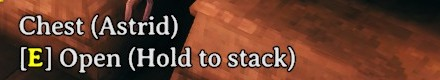 | 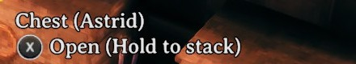 |

## Requirements

- [BepInExPack Valheim](https://thunderstore.io/c/valheim/p/denikson/BepInExPack_Valheim/)
- [Jotunn](https://thunderstore.io/c/valheim/p/ValheimModding/Jotunn/)
- [YamlDotNet](https://thunderstore.io/c/valheim/p/ValheimModding/YamlDotNet/)
- A controller that sends keyboard keys or mouse input (e.g. Steam Deck, Steam Controller, gamepad with Steam Input, etc.)

Client-side only: servers and other players don't need it.

## Features

### Prompts stay controller glyphs

Crosshair prompts, the hint bars and the inventory and crafting button badges keep showing controller glyphs after keyboard or mouse input. Setting: **Hint Glyphs > Force controller glyphs in Valheim hints**.

| Without BrrControllerGlyphs, after KBM input | With BrrControllerGlyphs |
| ------------- | ------------- |
| 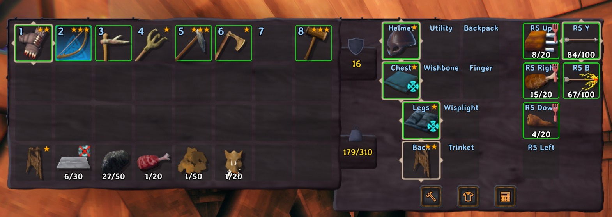 | 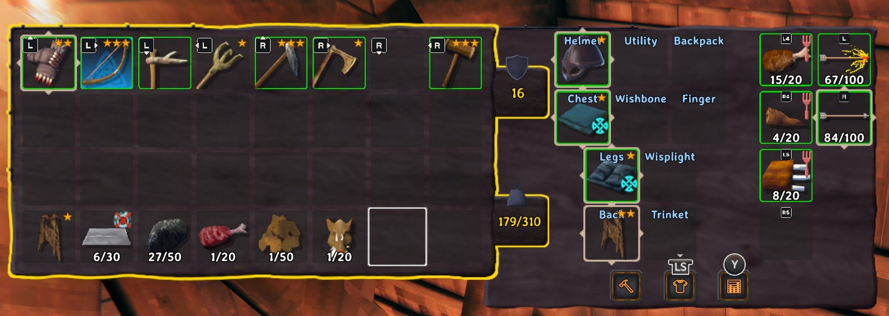 |

### Your buttons instead of keyboard keys

Keys your layout sends show as the buttons from your mapping file (see below). Buttons Valheim has no art for (back buttons L4, L5, R4, R5 and the trackpads) get Steam Deck-style glyphs. Setting: **General > Glyphs used by mod** picks `Valheim` art with Steam Deck art for the extra buttons, or `SteamDeck` art for all of them.

| Without BrrControllerGlyphs | Glyphs used by mod: Valheim | Glyphs used by mod: SteamDeck |
| ------------- | ------------- | ------------- |
| 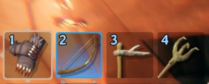 | 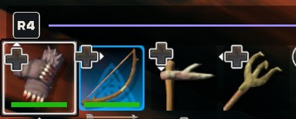 | 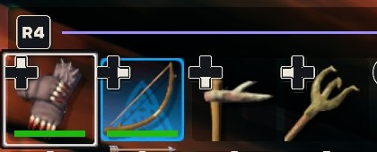 |

### Hotbar and quick-slot labels

The hotbar shows your buttons, grouped by the held button: one `R4` beside a run of slots, then each slot's own button. The same goes for AzuExtendedPlayerInventory's quick-slot bar and for both in the inventory. Settings: **Hotbar Glyphs > Force hotbar controller glyphs**, **Hotbar group colors** (`Neutral`, `Palette`, or `Custom` from your mapping's `colors`) and **Hotbar group background** (alpha 0 hides it).

| Without BrrControllerGlyphs | Hotbar group colors: Neutral | Hotbar group colors: Palette |
| ------------- | ------------- | ------------- |
| 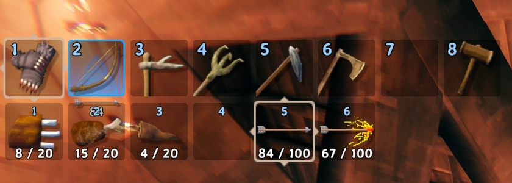 | 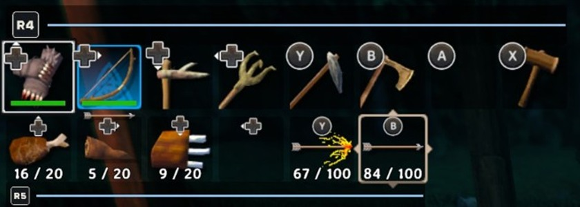 |  |

Slots that share a held button form a group; slots with a single button stand alone. How your bars group follows your mapping (example mappings: [no-groups](https://github.com/angiebrr/valheim-mod-brr-controller-glyphs/blob/main/docs/example-mappings/no-groups.yaml), [one-group](https://github.com/angiebrr/valheim-mod-brr-controller-glyphs/blob/main/docs/example-mappings/one-group.yaml), [multiple-groups](https://github.com/angiebrr/valheim-mod-brr-controller-glyphs/blob/main/docs/example-mappings/multiple-groups.yaml)). Quick slots are AzuExtendedPlayerInventory's.

| Mapping | HUD | HUD with quick slots | Inventory | Inventory with quick slots |
| ------------- | ------------- | ------------- | ------------- | ------------- |
| No groups | 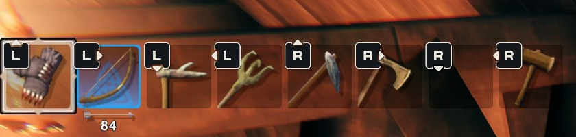 | 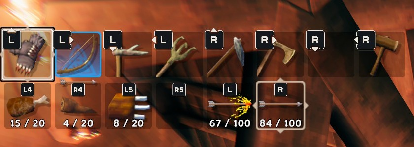 | 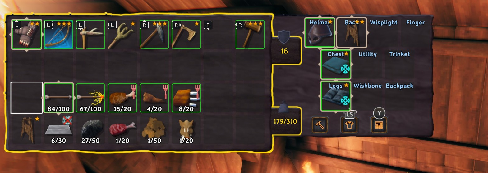 |  |
| One group | 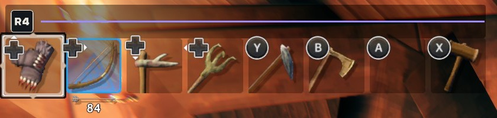 | 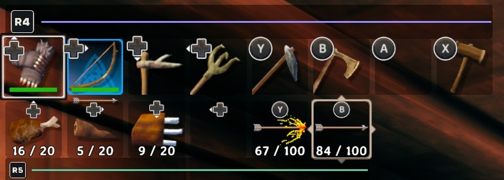 | 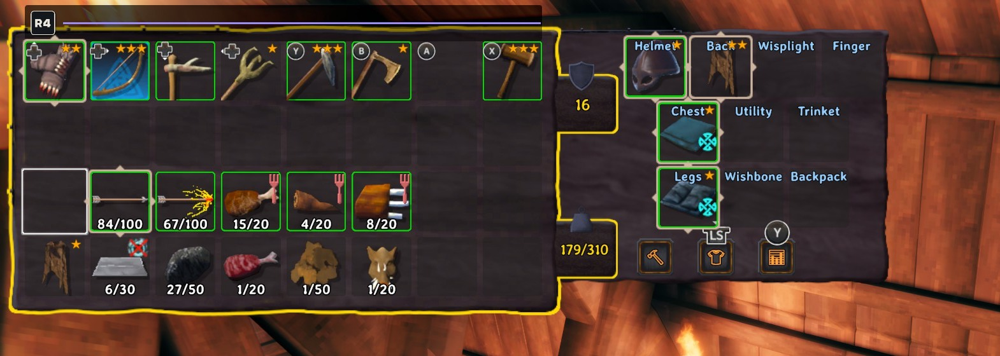 |  |
| Multiple groups | 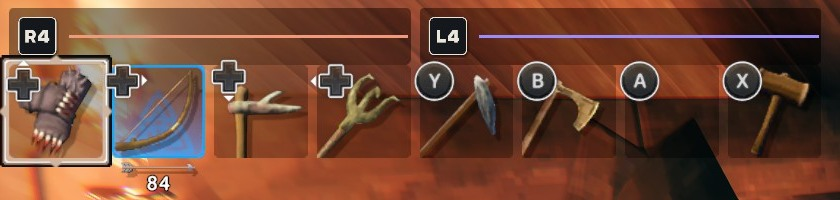 | 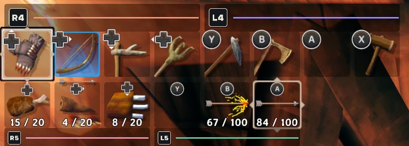 | 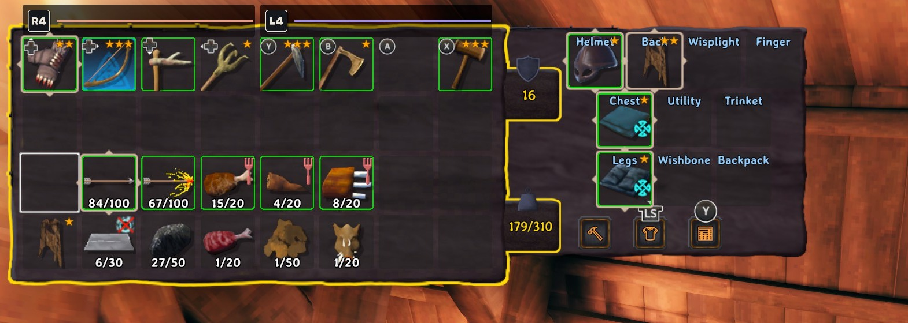 | 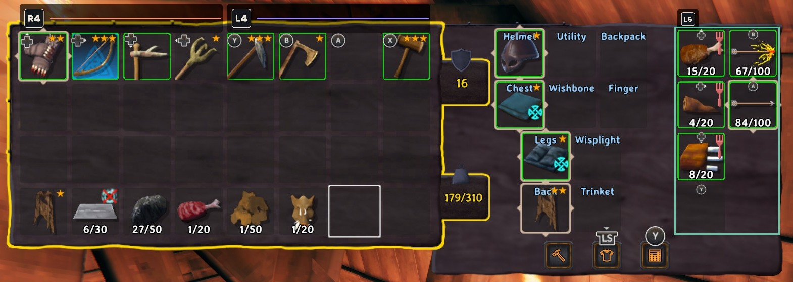 |

### Other mods' hover hints

Mods that write a key into their hover text, like `[B] AutoFuel` or `[Z] Favorite`, show your button instead. Setting: **Hint Glyphs > Force controller glyphs in mod hints**.

| Without BrrControllerGlyphs | With BrrControllerGlyphs |
| ------------- | ------------- |
| 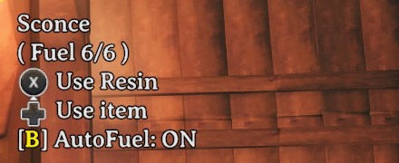 | 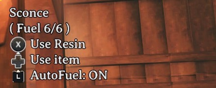 |

**General > Enabled** turns everything off; so does unplugging the gamepad.

## Setting up your mapping

The mod can't read your Steam layout. The mapping is a separate file that lists which buttons send which keyboard keys, so it has to match your layout, and you update it when you change the layout.

1. Start the game once. The mod writes a template to `BepInEx/config/BrrControllerGlyphs.mapping.yaml`. It maps nothing yet, so the glyphs already stay on and keyboard keys still show as keys.
2. Open Steam's controller configurator for Valheim and note each keyboard key your layout sends, and the button (or held button plus button) that sends it.
3. Write them under `keys`, one button or a list of buttons pressed together:

   ```yaml
   keys:
     "1": [R4, DPadUp]      # hotbar slot 1: hold R4 + D-pad up
     "2": [R4, DPadRight]
     Keypad1: [R5, DPadUp]  # AzuEPI quick slot 1: hold R5 + D-pad up
     Q: L5                  # pickup on a back button
     LeftShift: LPadDown    # left trackpad click down
   ```

4. Save. The mapping reloads while you play, and **Key Glyph Mapping > Mapping status** says whether it loaded or which line is wrong.
5. Play a while, then look at **Keys missing from mapping** (see [Checking your mapping against your mods](#checking-your-mapping-against-your-mods)). Add only keys your layout actually sends.

The template lists every button name with art and the key spellings that work. It also has three optional sections:

- `labels`: the text for a button shown as a text badge, e.g. `M1: Grip` shows `[Grip]`.
- `colors`: a color per held button for **Hotbar group colors** `Custom`, e.g. `R4: "#9B8CFF"`.
- `aliases`: another spelling of a key, for a mod that writes it oddly, e.g. `Pickup: Q`.

### Example mappings

Complete mapping files to copy and adapt; they're the ones behind the hotbar screenshots above. They only show the right buttons if your controller sends these keys from these buttons. The `Keypad` keys are AzuExtendedPlayerInventory's quick slots; without it they're simply unused.

<details>
<summary>One group per bar (the author's Steam Controller layout): <code>one-group.yaml</code></summary>

```yaml
# BrrControllerGlyphs example mapping: one group per bar.
# The author's Steam Controller layout: hotbar slots on an R4 hold, AzuEPI quick slots on an R5
# hold, extras on back grips and trackpad clicks. Copy to BepInEx/config/BrrControllerGlyphs.mapping.yaml.

keys:
  # Hotbar: hold R4 (one group)
  "1": [R4, DPadUp]
  "2": [R4, DPadRight]
  "3": [R4, DPadDown]
  "4": [R4, DPadLeft]
  "5": [R4, Y]
  "6": [R4, B]
  "7": [R4, A]
  "8": [R4, X]

  # AzuEPI quick slots: hold R5 (one group)
  Keypad1: [R5, DPadUp]
  Keypad2: [R5, DPadRight]
  Keypad3: [R5, DPadDown]
  Keypad4: [R5, DPadLeft]
  Keypad5: [R5, Y]
  Keypad6: [R5, B]

  I: [R5, A]           # backpack
  N: [R5, X]           # ImpactfulSkills AOE toggle
  Q: L5                # pickup
  Z: L4                # AzuAutoStore favorite
  B: LPadUp            # AutomaticFuel torch mode (left trackpad click up)
  LeftShift: LPadDown  # AzuCraftyBoxes fill all (left trackpad click down)
```

</details>

<details>
<summary>Two groups per bar: <code>multiple-groups.yaml</code></summary>

```yaml
# BrrControllerGlyphs example mapping: two groups per bar.
# Each bar is split between two held buttons: the hotbar on R4 and L4, AzuEPI's quick slots on R5
# and L5. Copy to BepInEx/config/BrrControllerGlyphs.mapping.yaml.

keys:
  # Hotbar: slots 1-4 hold R4, slots 5-8 hold L4 (two groups)
  "1": [R4, DPadUp]
  "2": [R4, DPadRight]
  "3": [R4, DPadDown]
  "4": [R4, DPadLeft]
  "5": [L4, Y]
  "6": [L4, B]
  "7": [L4, A]
  "8": [L4, X]

  # AzuEPI quick slots: 1-3 hold R5, 4-6 hold L5 (two groups)
  Keypad1: [R5, DPadUp]
  Keypad2: [R5, DPadRight]
  Keypad3: [R5, DPadDown]
  Keypad4: [L5, Y]
  Keypad5: [L5, B]
  Keypad6: [L5, A]

  B: LPadUp            # AutomaticFuel torch mode (left trackpad click up)
  LeftShift: LPadDown  # AzuCraftyBoxes fill all (left trackpad click down)
```

</details>

<details>
<summary>No groups (single buttons): <code>no-groups.yaml</code></summary>

```yaml
# BrrControllerGlyphs example mapping: no groups.
# Every slot is a single button (trackpad clicks and back grips), so nothing is held and each slot
# shows its own glyph. Copy to BepInEx/config/BrrControllerGlyphs.mapping.yaml.

keys:
  # Hotbar: left trackpad for 1-4, right trackpad for 5-8
  "1": LPadUp
  "2": LPadRight
  "3": LPadDown
  "4": LPadLeft
  "5": RPadUp
  "6": RPadRight
  "7": RPadDown
  "8": RPadLeft

  # AzuEPI quick slots: back grips and trackpad presses
  Keypad1: L4
  Keypad2: R4
  Keypad3: L5
  Keypad4: R5
  Keypad5: LPad
  Keypad6: RPad
```

</details>

## Checking your mapping against your mods

Other mods bring their own keys, and it's easy to miss one when you write your mapping. The mod checks your mapping against two sources and lists every keyboard key that's used but not mapped, so you can see what's left to add.

- **Other mods' keybinding settings.** At the main menu, the mod reads every keybinding setting (BepInEx `KeyboardShortcut` and `KeyCode` settings) of every loaded mod, including modifiers: AzuExtendedPlayerInventory's `Hotkey 7` set to `LeftAlt + Keypad7` needs both keys.
- **Hover hints you've seen.** Each time a hover hint shows a key in brackets that your mapping doesn't have, like `[E] Open`, the key is added with the hint's text and the mods that change that object's hover text. The mod is a best guess when several mods touch the same object.

The result is in **Key Glyph Mapping > Keys missing from mapping**. In ConfigurationManager it's a list per key with every place the key is used, for example:

```
E
├─ AzuCraftyBoxes > UI Hint > Pull from nearby containers
└─ SomeMod > Toggle key
LeftAlt
└─ AzuExtendedPlayerInventory > Hotkey 7 (Keypad7 + LeftAlt)
```

The `.cfg` file and Jotunn's Mod Settings show the same list on one line (`E (AzuCraftyBoxes, SomeMod), LeftAlt (AzuExtendedPlayerInventory)`), and `LogOutput.log` gets a line per key: for keybindings at the main menu, for hints the first time each key shows up.

What it leaves out, so the list stays useful:

- Mouse and joystick buttons, and unbound settings: only keyboard keys can come from your controller.
- Keys already in your mapping, in any spelling: `LeftControl` and `LeftCtrl`, or `Alpha1` and `1`, are the same key, and your `aliases` count.
- Keys a mod hard-codes or keeps outside its BepInEx config. Those still show up once you've seen them in a hover hint.

Not every key on the list needs a button. It lists what your mods use, but only keys your controller actually sends belong in the mapping. Ignore the rest; a key you never press has nothing to show.

The list updates when you save the mapping and when a hint shows a new missing key. **Mapping status** above it says whether the file loaded (`Loaded 30 keys`) or what's wrong and on which line, and ConfigurationManager shows a **Reload mapping** button next to it.

| Keys missing from mapping | Mapping status after a typo |
| ------------- | ------------- |
| 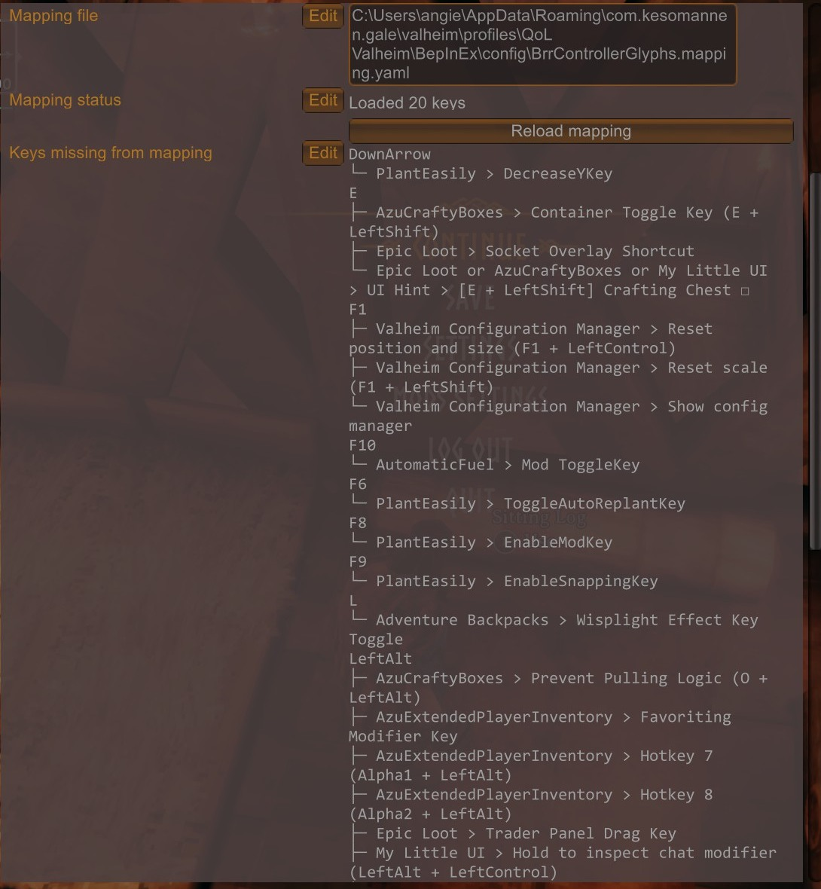 | 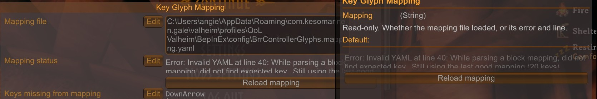 |

## Console commands (F5)

- `brrcg_reloadmapping`: reads the mapping file again.
- `brrcg_selftest`: checks the patches, gamepad detection and prompts, and writes the results to `LogOutput.log` (lines start with `[brrcg_selftest]`). Handy to include in a bug report.

## FAQ

**Does it change my input mode?** No. Valheim still knows when you used the keyboard or trackpad; the mod only changes which glyphs and labels are shown.

**Does the trackpad cursor still work?** Yes, in menus and the inventory, as before.

**Why does a hint still show a key?** That key isn't in your mapping, or the mod writes it in a way the mapping doesn't match. Check **Keys missing from mapping** (see [Checking your mapping against your mods](#checking-your-mapping-against-your-mods)), then add the key or an alias.

**Can I use it without a Steam Controller?** Yes. Any gamepad keeps its glyphs; the mapping is only needed for keys your layout sends.

**Can I add or remove it at any time?** Yes. It saves nothing in your world or character.

## Compatibility

- **AzuExtendedPlayerInventory:** the quick-slot bar and inventory quick slots are labelled (the inventory only in its `Legacy` layout for now; see Known issues).
- **MyLittleUI:** hover text and chest hints work.
- **ConfigurationManager (shudnal):** settings are ordered, with a reload button and the missing-keys list. Jotunn's Mod Settings shows them as plain text.
- **Mods with keys in their hover text** (AzuAutoStore, AzuCraftyBoxes, AutomaticFuel, ImpactfulSkills, ...) are translated through your mapping.

If a Valheim update changes something the mod patches, only that feature turns off, with a warning in the log.

## Limits

- The mod only sees the keyboard keys your controller sends. Held buttons, chords and action sets from Steam, for example, exist only as you write them in the mapping.
- Valheim's art and the mod's Steam Deck art differ a little; **Glyphs used by mod** `SteamDeck` makes the mod's glyphs match each other, but Valheim's own prompts keep Valheim's art.
- Some mods change their hints, and their controls, with Valheim's input mode. This mod keeps the glyphs on but never changes that mode, so after keyboard or trackpad input those mods show their keyboard version. For example, AzuCraftyBoxes' Crafting Chest hint reads `LT + X` on a gamepad but `[E + LeftShift]` after keyboard input, and then only E + LeftShift toggles the chest. Keys your controller sends show as your buttons (`LeftShift` as your trackpad click); the rest stay as keys. Press any gamepad button to switch back.
- Hints from Jotunn's KeyHintManager aren't changed yet.
- Stick directions and the PlayStation touchpad have no mapping names yet.

## Known issues

- **Switching features while playing:** turning the mod or its features off and on again while the game is running (**Enabled** and the other switches) can leave some labels or hints in the wrong state. Restarting the game fixes it.
- **AzuExtendedPlayerInventory's inventory layouts:** the inventory labels were built for its `Legacy` layout (**5 - UI Features > Inventory Layout**). In `EquipmentAndQuickSlots` the quick-slot cells keep AzuEPI's own names and the group outline lands on an empty spot; the other layouts (`Default`, `Tabbed`, `LegacyDetached`, `ExtraSlots`) aren't tested yet. Use `Legacy` for now if the inventory looks wrong.
- **AzuExtendedPlayerInventory's quick-slot bar on the HUD:** to make room for the group labels under the bar, Valheim's top-left messages move down a little. This assumes the bar is in its default place under the hotbar, and if you hide the bar while playing, the messages stay lower until you next load a world.

## Reporting issues

Open an issue on [GitHub](https://github.com/angiebrr/valheim-mod-brr-controller-glyphs/issues) with what you saw (a screenshot helps), your mapping file, and the `[brrcg_selftest]` lines from `LogOutput.log`.

## Credits

Controller glyphs made from [Input Prompts](https://kenney.nl/assets/input-prompts) by Kenney (CC0). Built with [Jötunn](https://github.com/Valheim-Modding/Jotunn).

## Changelog

- **0.0.1:** first version.
