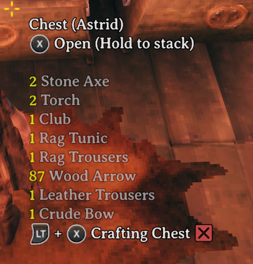
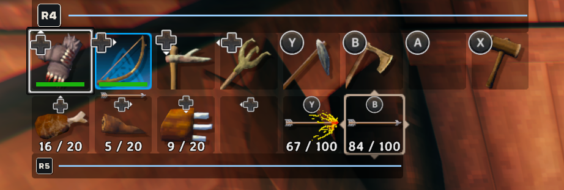
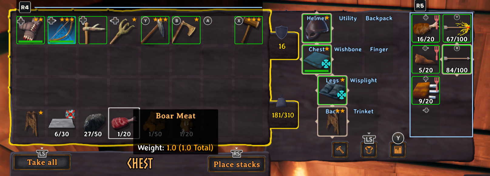
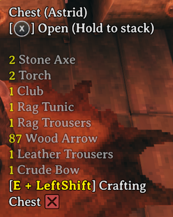

# BrrControllerGlyphs

Controller glyphs that stay put, even when your Steam Input layout sends keyboard keys.

I play Valheim on a Steam Controller. My layout sends real gamepad buttons for the core actions and keyboard keys for the extras: hotbar slots on an R4 hold, quick slots on R5, pickup on a back grip, mod hotkeys on trackpad clicks. Every one of those key presses flipped Valheim into keyboard mode. Prompts turned into keyboard keys, and the hotbar and mod hints showed `1`, `Z` or `LeftShift` instead of the button I actually press.

This mod keeps Valheim's controller glyphs on while a gamepad is connected, whatever the last input was. Keys your layout sends show as the buttons that send them, so hotbar slot 1 reads `R4 + D-pad Up`. Your input isn't touched: the trackpad cursor, run toggle and menu navigation work exactly as before.

| Vanilla, after a keyboard key | With BrrControllerGlyphs |
| ------------- | ------------- |
|  |  |

## Requirements

- [BepInExPack Valheim](https://thunderstore.io/c/valheim/p/denikson/BepInExPack_Valheim/)
- [Jotunn](https://thunderstore.io/c/valheim/p/ValheimModding/Jotunn/)
- [YamlDotNet](https://thunderstore.io/c/valheim/p/ValheimModding/YamlDotNet/)
- A controller through Steam Input (Steam Controller, Steam Deck, or any pad with a Steam layout that sends keyboard keys)

Client-side only: servers and other players don't need it.

## Features

### Prompts stay controller glyphs

Crosshair prompts, the hint bars and the inventory and crafting button badges keep showing controller glyphs after keyboard or mouse input. Setting: **Hint Glyphs > Force controller glyphs in Valheim hints**.

| Vanilla, after moving the trackpad cursor | With BrrControllerGlyphs |
| ------------- | ------------- |
|  |  |

### Your buttons instead of keyboard keys

Keys your layout sends show as the buttons from your mapping file (see below). Buttons Valheim has no art for (back buttons L4, L5, R4, R5 and the trackpads) get Steam Deck-style glyphs. Setting: **General > Glyphs used by mod** picks `Valheim` art with Steam Deck art for the extra buttons, or `SteamDeck` art for all of them.

| Vanilla | Glyphs used by mod: Valheim | Glyphs used by mod: SteamDeck |
| ------------- | ------------- | ------------- |
|  |  |  |

### Hotbar and quick-slot labels

The hotbar shows your buttons, grouped by the held button: one `R4` beside a run of slots, then each slot's own button. The same goes for AzuExtendedPlayerInventory's quick-slot bar and for both in the inventory. Settings: **Hotbar Glyphs > Force hotbar controller glyphs**, **Hotbar group colors** (`Neutral`, `Palette`, or `Custom` from your mapping's `colors`) and **Hotbar group background** (alpha 0 hides it).

| Vanilla | Hotbar group colors: Neutral | Hotbar group colors: Palette |
| ------------- | ------------- | ------------- |
|  |  |  |

Slots that share a held button form a group; slots with a single button stand alone. How your bars group follows your mapping (example mappings: [no-groups](https://github.com/angiebrr/valheim-mod-brr-controller-glyphs/blob/main/docs/example-mappings/no-groups.yaml), [one-group](https://github.com/angiebrr/valheim-mod-brr-controller-glyphs/blob/main/docs/example-mappings/one-group.yaml), [multiple-groups](https://github.com/angiebrr/valheim-mod-brr-controller-glyphs/blob/main/docs/example-mappings/multiple-groups.yaml)). Quick slots are AzuExtendedPlayerInventory's.

| Mapping | HUD | HUD with quick slots | Inventory | Inventory with quick slots |
| ------------- | ------------- | ------------- | ------------- | ------------- |
| No groups |  |  |  |  |
| One group |  |  |  |  |
| Multiple groups |  |  |  |  |

### Other mods' hover hints

Mods that write a key into their hover text, like `[B] AutoFuel` or `[Z] Favorite`, show your button instead. Setting: **Hint Glyphs > Force controller glyphs in mod hints**.

| Vanilla | With BrrControllerGlyphs |
| ------------- | ------------- |
|  |  |

**General > Enabled** turns everything off; so does unplugging the gamepad.

## Setting up your mapping

The mod can't read your Steam layout. The mapping is a separate file that lists which buttons send which keyboard keys, so it has to match your layout, and you update it when you change the layout.

1. Start the game once. The mod writes a template to `BepInEx/config/BrrControllerGlyphs.mapping.yaml`. It maps nothing yet, so the glyphs already stay on and keyboard keys still show as keys.
2. Open Steam's controller configurator for Valheim and note each keyboard key your layout sends, and the button (or held button plus button) that sends it.
3. Write them under `keys`, one button or a list of buttons pressed together:

   ```yaml
   keys:
     "1": [R4, DPadUp]      # hotbar slot 1: hold R4 + D-pad up
     "2": [R4, DPadRight]
     Keypad1: [R5, DPadUp]  # AzuEPI quick slot 1: hold R5 + D-pad up
     Q: L5                  # pickup on a back button
     LeftShift: LPadDown    # left trackpad click down
   ```

4. Save. The mapping reloads while you play, and **Key Glyph Mapping > Mapping status** says whether it loaded or which line is wrong.
5. Play a while, then look at **Keys missing from mapping**: keys that hover hints and other mods' keybindings use but your mapping lacks. Add only keys your layout actually sends.

The template lists every button name with art and the key spellings that work. It also has three optional sections:

- `labels`: the text for a button shown as a text badge, e.g. `M1: Grip` shows `[Grip]`.
- `colors`: a color per held button for **Hotbar group colors** `Custom`, e.g. `R4: "#9B8CFF"`.
- `aliases`: another spelling of a key, for a mod that writes it oddly, e.g. `Pickup: Q`.

## Console commands (F5)

- `brrcg_reloadmapping`: reads the mapping file again.
- `brrcg_selftest`: checks the patches, gamepad detection and prompts, and writes the results to `LogOutput.log` (lines start with `[brrcg_selftest]`). Handy to include in a bug report.

## FAQ

**Does it change my input mode?** No. Valheim still knows when you used the keyboard or trackpad; the mod only changes which glyphs and labels are shown.

**Does the trackpad cursor still work?** Yes, in menus and the inventory, as before.

**Why does a hint still show a key?** That key isn't in your mapping, or the mod writes it in a way the mapping doesn't match. Check **Keys missing from mapping**, then add the key or an alias.

**Can I use it without a Steam Controller?** Yes. Any gamepad keeps its glyphs; the mapping is only needed for keys your layout sends.

**Can I add or remove it at any time?** Yes. It saves nothing in your world or character.

## Compatibility

- **AzuExtendedPlayerInventory:** quick-slot bar and inventory quick slots are labelled.
- **MyLittleUI:** hover text and chest hints work; this mod runs after it.
- **ConfigurationManager (shudnal):** settings are ordered, with a reload button and the missing-keys list. Jotunn's Mod Settings shows them as plain text.
- **Mods with keys in their hover text** (AzuAutoStore, AzuCraftyBoxes, AutomaticFuel, ImpactfulSkills, ...) are translated through your mapping.

If a Valheim update changes something the mod patches, only that feature turns off, with a warning in the log.

## Limits

- The mod only sees the keyboard keys Steam sends. Held buttons, chords and action sets exist only as you write them in the mapping.
- Valheim's art and the mod's Steam Deck art differ a little; **Glyphs used by mod** `SteamDeck` makes the mod's glyphs match each other, but Valheim's own prompts keep Valheim's art.
- Hints from Jotunn's KeyHintManager aren't changed yet.
- Stick directions and the PlayStation touchpad have no mapping names yet.

## Known issues

- Turning the mod or its features off and on again while the game is running (**Enabled** and the other switches) can leave some labels or hints in the wrong state. Restarting the game fixes it.

## Reporting issues

Open an issue on [GitHub](https://github.com/angiebrr/valheim-mod-brr-controller-glyphs/issues) with what you saw (a screenshot helps), your mapping file, and the `[brrcg_selftest]` lines from `LogOutput.log`.

## Credits

Controller glyphs made from [Input Prompts](https://kenney.nl/assets/input-prompts) by Kenney (CC0). Built with [Jötunn](https://github.com/Valheim-Modding/Jotunn).

## Changelog

- **0.0.1:** first version.
